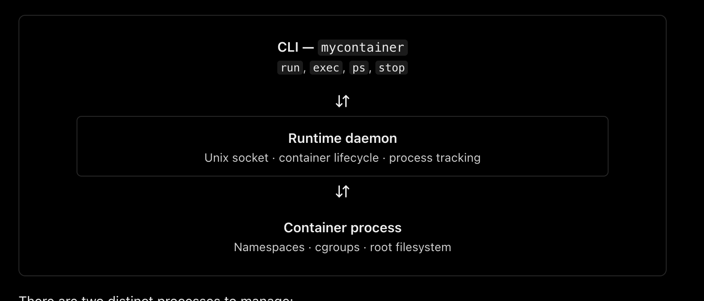

Here is the architectural roadmap to build a lightweight container runtime from scratch in Rust. Building a runtime involves setting up layers of isolation (namespaces), resource restrictions (cgroups), and filesystem sandboxing.
## Phase 1: Core Process Cloning & Isolation (Namespaces)
The foundation of a container is Linux Namespaces. This layer tricks the process into thinking it has its own dedicated operating system.

* Goal: Spawn a child process completely decoupled from the host.
* Key Tasks:
* Use nix::sched::unshare or unshare::Command to isolate specific namespaces.
   * CLONE_NEWPID: Ensures the containerized process becomes PID 1 inside its own tree.
   * CLONE_NEWNET: Cuts off host networking, providing a blank loopback interface.
   * CLONE_NEWNS: Decouples the mount table so changes inside don't alter the host.
   * CLONE_NEWUTS: Allows you to give the container a custom hostname (as implemented in the previous step).

## Phase 2: Root Filesystem & Chroot (Sandboxing)
An isolated process can still see your host files unless you jail it into its own root directory.

* Goal: Prevent the process from accessing your host machine's files.
* Key Tasks:
* Download or extract a minimal Linux filesystem (like an Alpine Linux rootfs tarball).
   * Use a pre_exec hook to invoke pivot_root (preferred) or chroot to swap the process's root directory to your downloaded rootfs.
   * Mount essential pseudo-filesystems inside the new root (like /proc for process tracking and /dev for device nodes).

## Phase 3: Resource Limiting (cgroups v2)
Without control groups (cgroups), a rogue container process can consume 100% of your host's CPU or memory (Fork Bomb / DoS).

* Goal: Enforce strict memory, CPU, and I/O caps on your spawned processes.
* Key Tasks:
* Use the [cgroups-rs crate](https://github.com/hustcat/cgroups-rs) to interact with the Linux cgroup v2 unified hierarchy (/sys/fs/cgroup).
   * Create a dedicated sub-cgroup directory for your container runtime.
   * Write strict limits to memory.max (e.g., max 512MB) and cpu.max.
   * Migrate the child process's PID into the cgroup's cgroup.procs file before it executes its workload.

## Phase 4: Basic Networking (Veth Pairs)
Because you unshared the network namespace (CLONE_NEWNET), your container will be entirely offline. You must build a virtual bridge to the host.

* Goal: Give the isolated process secure internet access or local cluster routing.
* Key Tasks:
* Create a veth pair (virtual ethernet) on the host using the rtnetlink crate.
   * Move one end of the veth pair into the child process's network namespace.
   * Set up an IP address inside the container and assign the host-side veth as the default gateway.
   * Configure IPTables / NFTables on the host to enable NAT (Network Address Translation) so the container can reach the outside internet.

## Phase 5: Dropping Privileges & Security Caps
Even inside namespaces, a process running as user ID 0 (root) still holds powerful Linux capabilities that could allow it to break out of the container.

* Goal: Enforce a "least privilege" security model.
* Key Tasks:
* User Namespaces (CLONE_NEWUSER): Map the host's unprivileged user to User ID 0 inside the container, meaning the process feels like root internally but has zero power if it escapes to the host.
   * Linux Capabilities: Use the caps crate to strictly drop dangerous system capabilities like CAP_SYS_ADMIN, CAP_NET_ADMIN, and CAP_SYS_RAWIO right before the binary executes.


## References
* https://www.youtube.com/watch?v=vvCLXeYwT58
* https://labs.iximiuz.com/tutorials/container-filesystem-from-scratch#prerequisites
* https://labs.iximiuz.com/tutorials/container-networking-from-scratch#materials-used-to-write-this-article
* 


```
myruntime/
├── Cargo.toml
└── src/
    ├── main.rs
    ├── cli.rs
    ├── daemon.rs
    ├── ipc.rs
    └── container/
        ├── mod.rs
        └── manager.rs
```


```
docker run -it \
  --privileged \
  --name ubuntu-lab \
  --cgroupns=host \
  -v /sys/fs/cgroup:/sys/fs/cgroup:rw \
  --mount type=bind,source=/Users/rahulchocha/Documents/Rahul/container-runtime,target=/workspace \
  -w /workspace \
  ubuntu:latest bash
```
